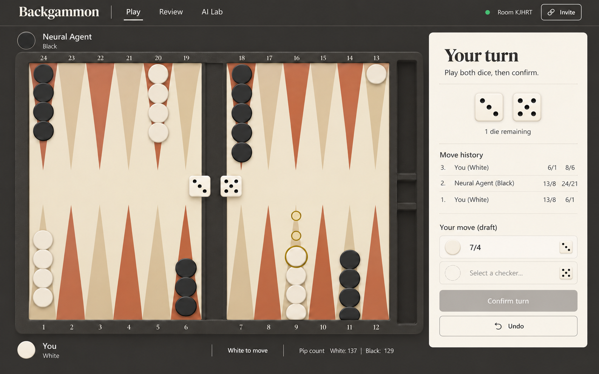

# Project improvements

The biggest improvements are **fixing rules and learning correctness, making evaluation trustworthy, and centralizing game-state changes**. Those affect model strength, training efficiency, multiplayer reliability, and frontend behavior.

This list is ranked by expected impact. Effort is relative to this project. Confirmed defects are distinguished from optimizations and algorithm changes that require benchmarking.

## Ranked improvements

1. **Fix legal-move generation and establish a reference implementation.**  
   **Impact: critical · Effort: medium**

   A reproduced position gives different legal moves for the same dice in a different order: `[5,3]` incorrectly produces no moves, while `[3,5]` correctly allows `16 → 19`. The search considers the first die without adequately exploring alternatives when that die is blocked. See [board_cpp.cpp:485](backend/classes/board_cpp.cpp#L485).

   Generate complete turns across all dice orders, then enforce maximum dice usage and the higher-die rule. Derive invalid dice from those results. Add property tests for dice-order invariance, color symmetry, checker conservation, and comparison against a deliberately simple reference generator. This protects gameplay, training data, and evaluations simultaneously.

   The minimal reproduction uses zero-based points: white has two checkers at point 16 and thirteen at point 23; black has thirteen at point 0 and two at point 21; every other point and both bars are empty. It is white's turn. Only the three can be played, regardless of dice order.

2. **Repair the neural network's training targets and terminal transitions.**  
   **Impact: critical · Effort: medium**

   The network outputs a probability through a sigmoid, but training supplies terminal rewards of `+1` and `−1`. A black win therefore requests an impossible negative probability. The update loop also skips training the final recorded state and applies the terminal reward one transition early. See [NNAgent.py:152](backend/classes/agents/NNAgent.py#L152) and [NNAgent.py:333](backend/classes/agents/NNAgent.py#L333).

   Define one value convention, such as white-win probability with targets `{0,1}`, and test learning on short, hand-calculable trajectories. Make terminal transitions explicit and use a consistent discount convention. These findings concern the current training code; they do not establish how historical checkpoints were trained.

3. **Correct MCTS's treatment of chance and player perspective.**  
   **Impact: critical · Effort: medium–large**

   Each node rolls dice once during construction, fixing one random future roll for that branch. Evaluations also mix root-player and white-player perspectives, while backpropagation flips signs by depth. See [CMCTS2.pyx:30](backend/classes/agents/CMCTS2.pyx#L30) and [CMCTS2.pyx:372](backend/classes/agents/CMCTS2.pyx#L372).

   Introduce separate decision and chance nodes. Sample chance outcomes repeatedly or enumerate the 21 unordered rolls with their correct probabilities: `1/36` for each double and `2/36` for each non-double. Choose one value perspective and apply it consistently through evaluation, selection, and backup.

4. **Rebuild evaluation around reproducible playing strength.**  
   **Impact: critical · Effort: medium**

   The heuristic baseline rewards white having more remaining pips and uses reversed home-board ranges. Strong results against it are consequently difficult to interpret. See [HeuristicAgent.py:39](backend/classes/agents/HeuristicAgent.py#L39).

   Retain the existing tournament infrastructure, but add corrected baselines, a pinned external engine, seeded dice, paired games with colors swapped, win-rate confidence intervals, and a fixed position suite. Measure move equity loss and probability calibration alongside wins. Report truncated games separately: the current evaluator adjudicates them using borne-off pieces and pips. At 500 independent games, a result near 50% has roughly **±4.4 percentage points** of sampling uncertainty at the 95% level.

   Seed the native dice source explicitly; seeding Python alone does not control the C++ generator. Include contact, race, and bearoff slices in the position suite, and verify expected versus completed tournament game counts.

5. **Route every mutation through one authorized game command service.**  
   **Impact: critical · Effort: medium**

   Current handlers have several reproduced gaps: an unrelated socket can replace a human seat with AI or reset another game, and a seated human can pass before rolling by submitting an empty sequence. AI setup can also roll a human player's dice. See [app.py:85](backend/app.py#L85), [app.py:142](backend/app.py#L142), and [app.py:209](backend/app.py#L209).

   Centralize identity, authorization, phase validation, transition application, persistence, and notification. Represent phases explicitly: awaiting roll, awaiting moves, and finished. Use separate seat/reconnect credentials alongside invitation room codes. Validate payloads, room existence, controller types, and supported AI models before changing state.

6. **Add revisions, command IDs, acknowledgements, and recovery snapshots.**  
   **Impact: very high · Effort: medium**

   Human commands have no shared mutation lock or optimistic concurrency control. The frontend clears submitted moves immediately, without acknowledgement, and can retain stale draft moves when a new snapshot arrives. See [app.py:155](backend/app.py#L155) and [Board.tsx:217](frontend/src/components/Board.tsx#L217).

   Give each command an ID and expected game revision. Apply it once, reject stale work, and acknowledge acceptance or rejection. Reconnect using a complete authoritative snapshot. Define validated event schemas with matching TypeScript types, structured errors, and consistent field names. Socket.IO's default delivery guarantee is at most once, so these guarantees require application logic. [Socket.IO documentation](https://socket.io/docs/v4/delivery-guarantees/)

7. **Fix persistence and add a compact, durable turn history.**  
   **Impact: very high · Effort: small–medium**

   Database updates omit `game_over` and `invalid_dice`; terminal state does not survive a round trip correctly. Player and AI configuration largely lives in process memory. See [app.py:61](backend/app.py#L61) and [models.py:18](backend/models.py#L18).

   Persist a versioned snapshot, controller configuration, and accepted turn records containing dice, moves, controller, model version, and revision. Commit snapshot and history together. Replace pickled positions with a validated portable representation during the schema migration. Deserialization failures should surface explicitly: the native constructor currently silently initializes a new board.

   Define explicit seat release, reconnect grace, presence expiry, and empty-room cleanup policies. Restore AI configuration after restart. Remove the debug `set_board` route or make it an authorized service command; it currently tries to insert a duplicate unique room code. Generate room codes against persisted uniqueness with collision retry.

8. **Run AI in a bounded process pool and keep models loaded.**  
   **Impact: very high for concurrent games · Effort: medium**

   AI runs inside the server runtime, and a neural checkpoint is loaded again on every turn. See [app.py:234](backend/app.py#L234).

   Start with long-lived local worker processes, each loading its inference model once. Bound the queue, expose deadlines, and discard results whose game revision or controller has changed. Compute outside the game's mutation lock. Coalesce duplicate AI tasks and cancel or discard work after resets, controller changes, or game completion. Keep mutable search trees scoped to their own games.

   Native compilation alone does not provide CPU isolation; pybind11 retains the GIL unless explicitly released. [pybind11 documentation](https://pybind11.readthedocs.io/en/stable/advanced/misc.html#global-interpreter-lock-gil)

9. **Separate compact board state from legal-move caches and search metadata.**  
   **Impact: high across training and search · Effort: medium–large**

   Cloning a board copies its entire legal-move collection. Neural selection clones that collection once per candidate, creating avoidable copying that grows quadratically with candidate count. See [board_cpp.cpp:39](backend/classes/board_cpp.cpp#L39) and [NNAgent.py:790](backend/classes/agents/NNAgent.py#L790).

   Introduce a small native `BoardState`, using fixed-size storage for the 24 points and dice. Keep generated moves separately. Benchmark cheap state copies against make/unmake operations, and provide an internal transition operation for already validated moves. Once search correctness is established, benchmark compact native tree storage, transposition tables, and reusable subtrees, with state keys that include the relevant turn, dice, and phase.

10. **Deduplicate resulting positions and generate features natively in batches.**  
    **Impact: high · Effort: small initially, medium for native batching**

    On the opening 1–2 roll, a local check found **21 sequences producing only 15 distinct resulting positions**. Evaluate each distinct position once, retaining a representative sequence.

    Candidate neural inference is already batched; much of the surrounding preparation remains Python work. A short profile attributed substantially more time to feature extraction than network execution. Cache `positions` and `valid_moves` locally immediately, then expose native generation of contiguous afterstate features. See [NNAgent.py:31](backend/classes/agents/NNAgent.py#L31).

11. **Give the value network an explicit state representation.**  
    **Impact: high · Effort: medium**

    The current 34 features omit whose turn it is. Changing only `board.turn` leaves the representation identical, despite potentially different winning chances.

    Define whether the network evaluates a position before rolling, a rolled decision state, or an afterstate. Include player-to-move information or canonicalize around a consistently defined player. Include dice when the chosen state definition requires them. Add color-swap augmentation and experiment with nonlinear checker-count channels, which can represent blots and made points more directly. Correct the anchor feature orientation and version feature semantics with the model.

12. **Replace pip-only race play with race and bearoff evaluation.**  
    **Impact: high playing-strength opportunity · Effort: medium–large**

    Once players pass, the agent switches to pip-minimizing play. Equal pip reductions can leave very different future bearoff prospects. See [CMCTS2.pyx:438](backend/classes/agents/CMCTS2.pyx#L438).

    Add an exact bearoff database or dynamic program for a manageable endgame subset, plus a calibrated race evaluator outside its coverage. Account for who moves next. These components also provide useful ground truth for model evaluation.

13. **Benchmark shallow expectiminimax against corrected MCTS.**  
    **Impact: potentially high · Effort: medium–large**

    Score distinct afterstates with the network, retain promising candidates, then evaluate opponent replies over weighted dice outcomes. Compare this with chance-aware MCTS at equal decision latency.

    This gives the project a concrete algorithmic alternative to increasingly expensive random rollouts. Neural evaluation combined with shallow search has direct precedent in [Tesauro's TD-Gammon work](https://www.bkgm.com/articles/tesauro/tdl.html). The winning approach here still requires experiments.

14. **Make rollout generation a persistent, explicitly versioned pipeline.**  
    **Impact: high for training throughput · Effort: medium–large**

    Training creates a new multiprocessing pool every epoch; evaluation creates another. Tasks submit bound methods carrying substantial trainer state. See [NNAgent.py:314](backend/classes/agents/NNAgent.py#L314).

    Use persistent actors with frozen, versioned model snapshots, independent seeds, compact trajectories, bounded queues, and controlled PyTorch thread counts. Make policy staleness and rollout/update ratios explicit. Keep eligibility traces local to each trajectory. Benchmark minibatched lambda-return learning as a separately specified training variant.

15. **Make model artifacts self-describing and training resumption reliable.**  
    **Impact: high · Effort: small–medium**

    Training currently constructs a `34 → 40 → 1` network, while serving hardcodes `34 → 128 → 128 → 1`. Resume filenames disagree with saved filenames, and `main()` overwrites the requested epoch count. See [NNAgent.py:749](backend/classes/agents/NNAgent.py#L749) and [NNAgent.py:819](backend/classes/agents/NNAgent.py#L819).

    Store architecture, feature schema, reward convention, rules version, configuration, RNG state, code revision, and evaluation evidence with each artifact. Use one strict loader across training, serving, and evaluation, with atomic checkpoint writes. Correct resume epoch accounting and learning-rate scheduling, and distinguish self-play white-win fraction from external evaluation strength.

16. **Refactor the frontend around authoritative state plus a draft turn.**  
    **Impact: high · Effort: medium**

    The 826-line board component combines networking, lobby setup, game transitions, input, geometry, and rendering. Several overlapping state variables can diverge. See [Board.tsx:37](frontend/src/components/Board.tsx#L37).

    Extract a session hook, pure draft reducer, lobby, and board view. Derive the preview from the authoritative snapshot plus draft moves. Drive controls from the server-confirmed role and phase; handle rejected seats, connection failures, partial turns, and submission errors visibly. Retain drafts until accepted, invalidate stale drafts when necessary, and clear selection and drag state on authoritative replacement. Provide loading, error, and retry states for creating and joining games.

17. **Make the board responsive and accessible across input methods.**  
    **Impact: high for usability · Effort: medium**

    The SVG uses fixed dimensions without a `viewBox`, and dragging uses mouse events. See [Board.tsx:615](frontend/src/components/Board.tsx#L615).

    Add responsive SVG scaling, Pointer Events with pointer capture, keyboard movement, focusable points, textual dice information, and accessible turn/error announcements. Correct coordinate transformation is essential once the board scales. Handle pointer cancellation and releases outside the board.

18. **Create reproducible builds and meaningful CI gates.**  
    **Impact: high · Effort: medium**

    Package native extensions through one supported build configuration, separate runtime dependencies from training/plotting extras, and automate clean installation.

    CI should cover native compilation, engine invariants, persistence round trips, concurrent commands, model loading, frontend checks, and two-browser gameplay/reconnection. Tournament execution should also fail visibly when worker jobs fail; currently asynchronous failures can disappear from the reported results. See [tournament.py:118](backend/classes/tournament.py#L118).

19. **Make deployment configurable, then scale from measured demand.**  
    **Impact: high for deployment · Effort: small–medium initially**

    The frontend points to `127.0.0.1`, and backend startup enables debugging on all interfaces. See [constants.ts:1](frontend/src/constants.ts#L1) and [app.py:338](backend/app.py#L338).

    Use same-origin production routing, environment configuration, explicit trusted origins, a production server, migrations, readiness checks, and structured logs. Keep a modular Flask application with AI workers. SQLite can support a small single-instance deployment; introduce PostgreSQL and shared Socket.IO coordination when concurrent writers and multiple instances require them. Shared broadcast coordination must be accompanied by authoritative game-command concurrency control. [Flask-SocketIO deployment guidance](https://flask-socketio.readthedocs.io/en/stable/deployment.html)

20. **Expand model objectives alongside the intended game rules.**  
    **Impact: potentially high · Effort: large**

    For stronger single-game play, experiment with residual MLPs, phase-specific evaluators, and a learned move-ranking policy that supplies search priors. Compare strength per millisecond and sample efficiency. Keep legal-move generation authoritative.

    For scored or match backgammon, introduce gammon/backgammon outcomes, doubling-cube ownership/value, match score, and corresponding equity objectives together. A single win probability cannot express all of those decisions.

## Smaller improvements

- **Remove artificial server delays.** Remove the one-second sleeps before selecting moves, after broadcasting, and when scheduling follow-up AI work. Let the client handle animation pacing. See [app.py:246](backend/app.py#L246).
- **Short-circuit forced moves and terminal positions.** Return immediately when there is one legal move, and handle terminal values exactly rather than asking the network or a race approximation to estimate them.
- **Avoid repeated database work.** Update the row already loaded by a command and remove redundant sorting on unique room codes. See [app.py:61](backend/app.py#L61).
- **Index room membership and expire unused rooms.** Maintain a reverse socket-to-membership mapping instead of scanning every room during disconnect. Reuse the explicit presence and expiry policies described above.
- **Precompute frontend legal destinations.** Use sets or a move-prefix trie, and recompute them when the authoritative state or draft changes. Avoid scanning all legal sequences for each destination during each render. See [Board.tsx:341](frontend/src/components/Board.tsx#L341).
- **Isolate drag rendering.** Separate the moving checker overlay from static board geometry, memoize stable board elements, and use animation-frame scheduling if profiling shows a benefit. Actual frame-rate gains remain unmeasured.
- **Reduce inference preparation overhead.** Cache exposed native vectors locally, use the native clone operation where appropriate, allocate one contiguous tensor batch, set evaluation mode once, and benchmark `torch.inference_mode()`. Consider batching across simultaneous games after measuring queueing and latency tradeoffs.
- **Disable expensive development diagnostics during ordinary runs.** Turn off verbose board serialization/logging and normal-training anomaly detection. Keep diagnostics available through explicit configuration. See [NNAgent.py:807](backend/classes/agents/NNAgent.py#L807).
- **Measure compilation behavior.** Check graph breaks and recompilation in the decorated variable-length TD update; benchmark compiling stable tensor kernels. See [NNAgent.py:126](backend/classes/agents/NNAgent.py#L126).
- **Repair misleading benchmarks.** The existing dice benchmark repeatedly calls `set_dice()` on an already rolled board, so it measures mostly early returns. Reset or recreate the relevant state for each meaningful operation. See [test.py:8](backend/classes/test.py#L8).
- **Remove unused frontend dependencies and starter code.** Review unused packages such as `framer-motion`, `@million/lint`, and the frontend `socket.io` server package, plus dead starter assets, CSS, and the unused error page.
- **Track operational and model performance together.** Measure human-command latency during concurrent AI searches, unique positions evaluated per second, rollout throughput, queue time, database latency, calibration, move error, and truncation/error counts. Use these measurements to choose subsequent optimizations.

## Complete UI overhaul concept

**Impact: high for usability and product identity · Effort: large**

Give the application the feel of a modern backgammon club: warm ivory and sand surfaces, charcoal text and checkers, terracotta points, and restrained bronze accents. Use a restrained serif for the wordmark and clean sans-serif typography for controls, with generous spacing, subtle separators, and clear visual hierarchy. The board remains the visual focus, and the current situation and next action are always obvious.

**Color constraints:** Green may appear in small, purposeful success or connected indicators, accompanied by text or icons. Keep green out of the overall theme, dominant surfaces, navigation, board, and buttons. Exclude purple entirely across backgrounds, board elements, controls, status indicators, focus and selection treatments, charts, themes, and disabled and hover states. Use the main palette for those interface elements and interaction states; charts may use small green marks only when they convey a meaningful success status. Communicate status through text or icons as well as color.

The image is a visual concept with illustrative game data. The overhaul would cover five connected experiences:

1. **Home and match setup.** Offer a compact choice between **Play a person**, **Play an AI**, and **Watch AIs**. Each mode reveals only the relevant settings. Invitations work through a link or room code. Show useful agent descriptions and decision-time settings, with measured strength and model versions when available. Confirm the accepted seat before entering the match.

2. **Playing.** Let the board occupy most of the screen, oriented toward the player's seat. Place player identities above and below it. A narrow side panel shows dice, move history, the draft turn, and one primary action that changes with the situation: **Roll dice**, **Confirm turn**, or **Waiting for opponent**. Show remaining dice and explicit **No legal moves** feedback. Keep room sharing and connection status in a quiet top bar, and keep restarting separate from undoing draft moves.

3. **Review.** Reuse the board with a move timeline, previous/next controls, alternative moves, and optional evaluation. Selecting a move previews its resulting position. Show analysis here or in an explicitly enabled practice mode. AI spectator mode adds pause, playback speed, and single-turn stepping, with both agents and their model versions visible.

4. **AI Lab.** Provide a separate workspace for comparing agents and checkpoints, viewing training curves, running tournaments, and inspecting strength, uncertainty, and decision time. Include position analysis and comparisons of playing strength against latency. Keep ordinary matches focused on playing.

5. **Mobile.** Make the board fill the available width, use compact player information, and place a persistent action bar underneath. Open history and analysis in a bottom sheet. Support tap-to-move alongside dragging, with comfortable touch targets and readable status. Preserve keyboard access and accessible announcements across layouts.

Make interactions deliberate: highlight legal destinations, animate checker movement subtly, keep draft moves reversible, and visibly confirm that submitted turns were accepted. Show connection problems and rejected actions beside the relevant control. Disable confirmation until the full required turn is complete, and communicate why an action is unavailable.

Review and AI Lab would be new product capabilities supported by saved-game history, replay, and evaluation APIs. Implement them alongside the persistence, protocol, and evaluation improvements above. The central design goal is that players always understand their seat, whose turn it is, whether the game is connected, and what they can do next.

## Verification baseline

The read-only review found **23 engine tests and six reconnection tests passing**. Frontend type checking passed; lint reported **21 errors and three warnings**. The reproduced defects above expose coverage gaps, so strengthening those checks should accompany the first fixes.

Performance measurements were short local probes. Proposed gains from revised data structures, search methods, worker architecture, frontend rendering, or model architectures require representative benchmarks and playing-strength experiments.
